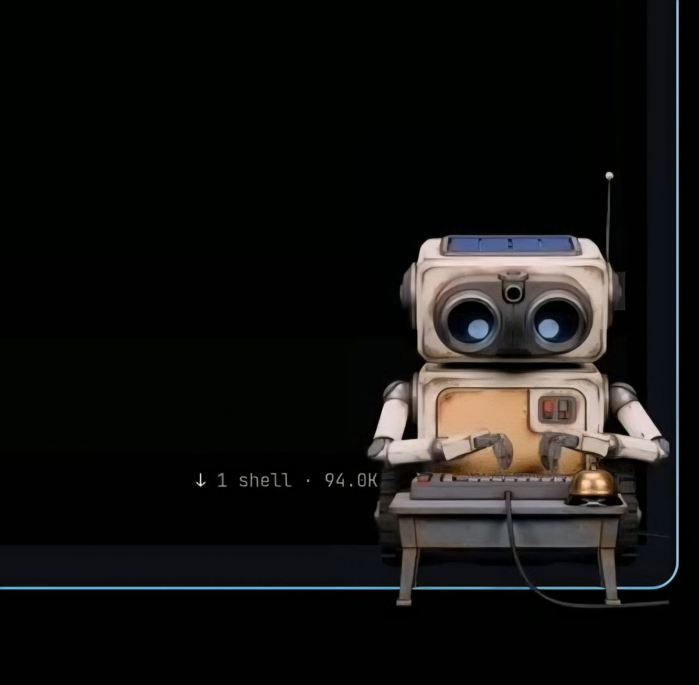

# Omarchy AI desktop agent

A small desk robot for the Omarchy shell that reacts to your AI coding agents.
While Hermes or OpenCode work, the pet types at a desk; when a turn finishes it
rings a bell, then sits waiting before hiding itself.



## Features

- Live pose per agent state: **working** (typing), **waiting** (needs your
  input), **done** (bell pose).
- Auto-hide: appears when work starts, hides when nothing is running.
- Rings the bell when a turn finishes — repeat rings every 5 minutes (3 total),
  then auto-hides after 15 minutes of rest.
- Bar on/off switch: robot icon, blue = enabled, grey = disabled.
- Draggable desk toy with gravity — throw it around your screen.
- Tracks multiple agents and sessions at once.

## Requirements

- Omarchy with the Quattro shell (Hyprland/Wayland).
- One or both agent bridges:
  - **Hermes** (`hermes-agent`) — optional but recommended. Adds hooks so the
    pet reacts to tool calls and turn completions.
  - **OpenCode** — optional. A small plugin adds session events for OpenCode.
- `pw-play` (PipeWire) for the bell sound, or set `bellSound: "off"`.
- `jq` for the event bridge scripts (falls back to printf if absent).

## Installation

The plugin is a git checkout placed in the Omarchy plugins folder:

```sh
git clone https://github.com/a77lic7ion/omarchy-ai-desktop-agent.git \
  ~/.config/omarchy/plugins/shaun.agent-pet
```

Then register it with the shell:

```sh
omarchy plugin enable shaun.agent-pet
```

Add the bar widget wherever you like (usually the right section) via the
Omarchy settings, or edit `~/.config/omarchy/shell.json`:

```json
"plugins": [ { "id": "shaun.agent-pet" } ],
"bar": { "layout": { "right": [ { "id": "shaun.agent-pet" } ] } }
```

Restart the shell once: `omarchy restart shell`.

### Enable the Hermes bridge (optional)

Wired in `~/.hermes/config.yaml` — the pet hooks into Hermes' shell hooks:

```yaml
hooks:
  pre_tool_call:   [{command: "~/.config/omarchy/plugins/shaun.agent-pet/hooks/hermes/agent-pet-hook.sh", timeout: 5}]
  post_tool_call:  [{command: "~/.config/omarchy/plugins/shaun.agent-pet/hooks/hermes/agent-pet-hook.sh", timeout: 5}]
  pre_verify:      [{command: "~/.config/omarchy/plugins/shaun.agent-pet/hooks/hermes/agent-pet-hook.sh", timeout: 5}]
  post_llm_call:   [{command: "~/.config/omarchy/plugins/shaun.agent-pet/hooks/hermes/agent-pet-hook.sh", timeout: 5}]
  agent_loop_stopped: [{command: "~/.config/omarchy/plugins/shaun.agent-pet/hooks/hermes/agent-pet-hook.sh", timeout: 5}]
  subagent_stop:   [{command: "~/.config/omarchy/plugins/shaun.agent-pet/hooks/hermes/agent-pet-hook.sh", timeout: 5}]
  on_session_start:[{command: "~/.config/omarchy/plugins/shaun.agent-pet/hooks/hermes/agent-pet-hook.sh", timeout: 5}]
  on_session_end:  [{command: "~/.config/omarchy/plugins/shaun.agent-pet/hooks/hermes/agent-pet-hook.sh", timeout: 5}]
```

Hermes needs the hooks allowlisted. For a long-lived gateway, either approve
them at a CLI prompt or enable auto-accept:

```sh
hermes config set hooks_auto_accept true
```

(The gateway picks it up within about 30 seconds.)

### Enable the OpenCode bridge (optional)

Install the plugin into OpenCode's plugin folder:

```sh
cp -r ~/.config/omarchy/plugins/shaun.agent-pet/hooks/opencode/agent-pet \
  ~/.config/opencode/plugins/agent-pet
```

Set `PET_DEBUG=1` in OpenCode's environment to log events to
`~/.local/state/agent-pet/opencode-events.log`.

## Usage

Click the robot in the bar to turn the pet on/off. Drag the pet around the
screen. Send a task to Hermes or OpenCode and watch it react.

From a terminal:

```sh
omarchy-shell agent-pet state          # JSON status
omarchy-shell agent-pet toggle         # on/off
omarchy-shell agent-pet setEnabled on  # or off
omarchy-shell agent-pet play done      # force a pose
omarchy-shell agent-pet reload         # re-read config
```

## Configuration

Optional per-user config at `~/.config/agent-pet/config.json` (defaults come
from `assets/config.json`):

| key | default | meaning |
|---|---|---|
| `size` | 560 | pet width px |
| `screen` | `""` | screen name; empty = first screen |
| `layer` | `top` | `top` or `overlay` |
| `gravity` | 1400 | fall acceleration px/s² |
| `throwPower` | 1.0 | drag throw multiplier |
| `bottomMargin` | 0 | clearance above the floor |
| `sessionTtl` | 900 | forget session after N s |
| `workingTtl` | 90 | silence → rest pose |
| `doneHold` | 4 | show the bell pose for N s |
| `restTtl` | 900 | stay visible, waiting, after a finish (s) |
| `bellRings` | 3 | bell rings total per finish (1 + repeats) |
| `bellInterval` | 300 | seconds between repeat rings |
| `bellSound` | `""` | wav path; `"off"` = silent, `""` = bundled |
| `bellVolume` | 0.9 | bell volume 0.0–1.0 |
| `autoHide` | true | hide pet when no agent session is live |
| `startX` | 0.5 | initial horizontal position (0..1) |

## Removal

```sh
omarchy plugin disable shaun.agent-pet
rm -rf ~/.config/omarchy/plugins/shaun.agent-pet
```

Remove the Hermes hooks from `~/.hermes/config.yaml` if you added them, and
delete the OpenCode plugin folder if installed.

## Security

No privileged commands, no config overwriting, no telemetry. The service only
listens on a Unix socket under `$XDG_RUNTIME_DIR/agent-pet/` for
agent-event JSON lines. The bell plays via `pw-play` on the local sound
server. The pet renders as a transparent layer-shell window that ignores input
except on the body.

## License

[MIT](LICENSE)
